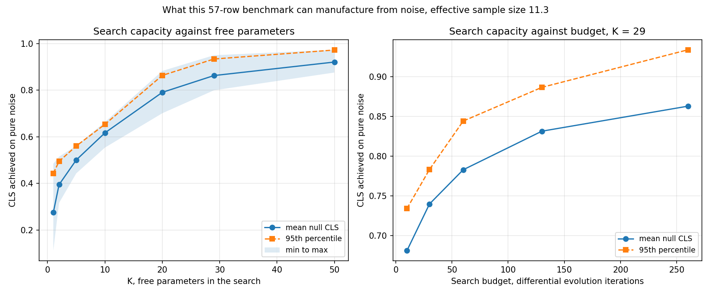

# RT-plm-benchmark

This repository is a methodological rebuild of
[TanishDevs11/RT-Activity-Predictor](https://github.com/TanishDevs11/RT-Activity-Predictor).
The original holds the submitted competition artifact and is **not modified by this
work**: no push, no branch, no tag, no pull request. It was cloned once at commit
`c1620706685d1a29e874031abd62d88a763d241e`, tagged here as `provenance`.

## Status: the benchmark is being rebuilt as a multi-task benchmark

Everything below the next three sections is the completed single-task work on the 57-RT
cross-family panel, and it stands. Since 2026-09-30 that panel is being rebuilt as **Task A**
of a multi-task benchmark, so that a cross-family transfer task can be contrasted against a
within-protein variant effect task. Progress is in
[reports/progress_2026-09-30.md](reports/progress_2026-09-30.md).

| task | what it measures | assay | status |
| --- | --- | --- | --- |
| **A** cross-family | does a representation transfer across RT families | prime editing, percent precise edits, HEK293T | **complete**, 57 sequences from Table S1, endorsed through Gate G2; see [reports/FINAL_REPORT.md](reports/FINAL_REPORT.md) |
| **A2** evolved | transfer onto selected variants, evaluation only | prime editing, evolved editors in their own scaffolds | not acquired |
| **B** M-MLV DMS | within-protein variant effect | prime editing, normalized so wild type is zero | **blocked at acquisition**, re-attempted 2026-10-03 by eleven routes; splits and reference ready, labels never deposited. See [reports/taskB/FINAL_REPORT.md](reports/taskB/FINAL_REPORT.md) |
| C retron, C DGR, C retroviral | breadth of representation analysis | msDNA, mutagenic homing, in vitro kinetics | **blocked**, no usable panel found |

The scientific point of running A and B together is the contrast. Protein language models are
known to do well on within-protein variant effect prediction, and the audit in this repository
measured raw ESM-2 embeddings at CLS 0.3052 on the cross-family task, below what protein length
alone achieves with no training. If that contrast holds under a clean protocol, the finding is
that these representations capture lineage and local mutational tolerance but not cross-family
functional transfer.

## Why labels are never merged across assays

**There is no merged label column in this repository, and no code path that produces one.**

Activity measurements in the reverse transcriptase literature are not commensurable. Prime
editing efficiency in HEK293T, retron msDNA production, DGR adenine mutagenesis rate, and in
vitro nucleotide incorporation are four different physical quantities in four different units.
Assay type is also almost perfectly confounded with RT family, because each family was
characterised by a different subfield using its own readout.

So if those numbers shared a column, a leave-one-family-out split would silently become a
leave-one-assay-out split, and a model could score well by learning which publication a
sequence came from rather than anything about catalysis. That is not a hypothetical: the audit
already found that mean-pooled embeddings on this panel carry lineage signal.

Each assay is therefore its own task, with its own label scale, its own split, and its own
reported metric. This is enforced mechanically, not by convention. `schemas/task_schema.py`
rejects a table carrying two tasks, rejects inconsistent units inside a task, and refuses to
concatenate tables whose `label_units` or `label_assay` differ;
`schemas/test_task_schema.py` proves the refusal holds both through the helper and when a
merged frame is built by hand with plain pandas.

Cross-task comparison is still the point of the exercise. It happens in explicitly labelled
representation-analysis code that keeps the label columns separate, never by stacking rows.

## Headline result: Task A, the rebuilt cross-family benchmark

**Do protein language models improve reverse transcriptase activity prediction over
simpler biological representations, under family-held-out evaluation? No.**

Twelve representations, two model heads (regularized logistic regression and ridge, and
nothing else), one free parameter selected in the inner loop of a nested
leave-one-family-out protocol.

- [reports/MANUSCRIPT_SUMMARY.md](reports/MANUSCRIPT_SUMMARY.md) reads it as a paper would.
- [reports/FINAL_REPORT.md](reports/FINAL_REPORT.md) is the auditable version, by phase.

| | classification PR-AUC | Gaussian noise control | permuted-label p95 | survives |
| --- | --- | --- | --- | --- |
| **`kmer4`**, 4-mer frequencies | **0.6212** | 0.4458 | 0.5398 | **yes** |
| ESM-2 650M | 0.4220 | 0.2889 | 0.5217 | no |
| ESM-2 8M | 0.3706 | 0.2581 | 0.5676 | no |
| `physicochemical` | 0.3623 | 0.2643 | 0.4254 | no |
| `length` alone | 0.2599 | 0.2474 | 0.4111 | no |

Chance PR-AUC is the positive prevalence, 0.3684.

Four things in that table are the result:

1. **No ESM-2 size survives.** 650M and 8M both clear their dimensionality-matched
   Gaussian noise controls and then lose to their own shuffled labels. The noise control
   alone would have passed them, which is exactly why the permutation test is not
   optional.
2. **The single survivor is not a language model.** A 4-mer frequency block clears its
   noise control, chance, and its permuted-label p95.
3. **Even that survivor is substantially a length detector.** Its out-of-fold score
   ranks with sequence length at Spearman **+0.52**, its top 1 percent of features carry
   only 6.6 percent of the attribution mass, and per-feature importance correlates
   positively with how much of each feature family explains. There is no motif finding
   here.
4. **Nothing clears the composite CLS metric at all.** The highest CLS is 0.3739 against
   a search-capacity null p95 of **0.4433** at the one free parameter used, every
   bootstrap interval on CLS includes zero, and the median resolvable CLS difference on
   this panel, **0.4816**, is larger than every CLS observed.

The dataset limits are the honest explanation for much of this: 57 enzymes, 21
positives, a Kish effective sample size of **11.34**, and three of seven
leave-one-family-out folds containing no active enzyme at all.

### The earlier single-task result, which stands

**No method tested beats using `protein_length_aa` as the score with no training at
all, and no method clears the score its own selection procedure reaches on pure
noise.**

| | CLS |
| --- | --- |
| 3-mer cosine to nearest training active, zero training | **0.4576** |
| `protein_length_aa`, zero training | **0.4416** |
| Best trained model (handcrafted + RandomForest) | 0.4284 |
| Best protein language model representation (ESM-2 150M) | 0.3052 |
| Minimum difference this benchmark can resolve at 80 percent power | **0.3419** |

The previously reported 0.9754 does not appear in this table. The reasons are in
[WRITEUP.md](WRITEUP.md), in the section titled "Why the previously reported 0.975
is not a result", and are summarised next.

## Why the previously reported 0.975 is not a result

I optimized the competition metric directly against the labels it was scored on.
`fast_opt.py` maximizes `compute_cls` over all 57 rows with 29 blend weights plus a
power exponent, and reseeds itself from its own previously fitted constants, so
each run resumes the prior hill climb. The commit history records 20 messages
quoting a CLS, climbing 0.4380 to 0.9754.

Running that same search on **pure Gaussian noise**:

| Free parameters | CLS on noise (p95) |
| --- | --- |
| **29, the matched count** | **0.9340** |
| 50 | 0.9727 |

**Corrected 2026-10-03.** This section previously bolded the K=50 row and concluded
that the submitted score "sits within its own noise floor". That was an invalid
comparison: it compared a 29-parameter search against the noise ceiling of a
50-parameter one. The 62 fitted parameters quoted here belong to a different stored
artifact, which scored 0.8978, not to the submission.

At the **matched** count of 29 free parameters the p95 is 0.9340, so the submission's
0.9754 sits **above** its noise floor by +0.0414, not below it. The correct statement is
weaker in a different way: that margin is about half the **0.0794** bootstrap interval
width on the submitted vector, against a Kish effective sample size of **11.34**, so the
score is **not distinguishable** from what the procedure manufactures from noise. It is
not shown to be inside the null, and it is not shown to be outside it either.

The leakage finding does not depend on this comparison. It rests on the static and
dynamic evidence in [audit/leakage_report.md](audit/leakage_report.md): the inherited
search optimises `compute_cls` directly against the test labels and reseeds itself from
its own previously fitted constants.

## The instrument

The contribution here is the **search-capacity null**: run a selection procedure,
unchanged, on K vectors of pure noise and record the score it reaches. That is how
much of a reported score the procedure can manufacture from nothing on this dataset
with this metric. Every score in this repository carries one, plus a bootstrap
interval. A score that does not clear its null has reported nothing.



## Three verified findings about protein language model embeddings

All three are now reproduced by scripts in this repository against the curated Task A
table, where previously two of them were published without code behind them.

- ESM-2 embeddings classify RT **family** at **0.8197** five-fold accuracy against a
  **0.3214** majority baseline, and the accuracy rises monotonically with model scale:
  0.7652 at 8M, 0.7833 at 35M, 0.8030 at 150M, 0.8197 at 650M.
- Embedding **PC1 tracks sequence length** at Spearman **-0.7681**, reproducing the
  published figure exactly.
- The same 650M representation that classifies family at 0.8197 predicts activity out of
  family at a PR-AUC of **0.4220**, which does not survive its own permuted labels.

That contrast is the finding: **the representation knows what an enzyme is related to,
and how long it is, and not what it does.**

The representation knows what an enzyme is related to. It does not know what it
does. Length residualization, family residualization, catalytic-core pooling and
attention-weighted pooling all failed to fix this, and the two core-focused
variants became the **most** lineage-predictive of all at 0.818 family accuracy.

## Layout

| Path | Contents |
| --- | --- |
| `reports/CROSS_TASK_COMPARISON.md` | **What the pair of tasks does and does not establish** |
| `reports/taskB/` | Task B: split design, final report, both written against a blocked dataset |
| `reports/MANUSCRIPT_SUMMARY.md` | **Task A, manuscript-style**, generated from the result files |
| `reports/FINAL_REPORT.md` | **Task A final report**, phase by phase, generated from the result files |
| `tasks/taskA_crossfamily/` | Task A: raw Table S1, curated table, frozen splits, provenance |
| `audit/` | Leakage audit and metric properties of the inherited tree |
| `bench/protocol.py` | The nested LOFO harness every experiment calls |
| `bench/search_null.py` | Search-capacity null, the central instrument |
| `bench/baselines.py` | Baseline ladder |
| `bench/representations.py` | Representation benchmark |
| `bench/names.py` | Repairs an inherited RT-name join defect, fails loudly |
| `bench/results/` | All measured results |
| `legacy_leaky/` | Quarantined inherited code. Not usable in any results table |
| `legacy_submission/` | The submitted artifact, as the object of study |
| `tasks/` | One directory per task: `raw/`, `curated.csv`, `splits/`, `PROVENANCE.md` |
| `schemas/task_schema.py` | The shared row schema and the validator that forbids merged labels |
| `data_acquisition/` | Source parsers, the manual fetch checklist, the reference resolver |
| `curation/` | Identity clustering and the frozen split definitions |
| `features/handcrafted/` | Feature matrices, missingness masks, and the feature dictionary |
| `embeddings/` | Representation matrices, zero-shot scores, and `MANIFEST.json` |
| `reports/` | Acquisition plan, split design, progress records |
| `PROGRESS.md` | Dated execution record |

## Reproducing

```
python reproduce.py          # everything, several hours
python reproduce.py --quick  # skips the null sweep and embedding extraction
```

Retrains everything from `data/` to predictions and reads no stored result. Seed 42
throughout; every script prints its seed and library versions.

`make reproduce` runs the same sequence and there are also `make audit`, `make
test`, `make null`, `make bench` and `make scale` targets. The Makefile is provided
untested: `make` is not installed on the machine these results were produced on, so
`reproduce.py` is the entry point that has actually been exercised here. Run the
heavy stages one at a time; extraction loads a 650M parameter model, and on a
memory constrained machine parallel stages get terminated.

Environment for every number reported: Python 3.14.2 on Windows 11, numpy 2.4.2,
scipy 1.17.1, pandas 3.0.1, scikit-learn 1.8.0, matplotlib 3.10.8, torch
2.11.0+cpu with zero CUDA devices, fair-esm 2.0.0.

## Protocol integrity

`bench/test_protocol.py` corrupts every held-out label and requires the selected
configuration to be byte-identical, and includes a deliberate **peeking positive
control** that the check must reject. The control is the load-bearing test: a green
suite in which peeking also passed would mean the check is inert. Continuous
integration runs it on every push, alongside a self-check on the null instrument.

## Blocked experiments

ProtT5-XL-U50, inverse-folding likelihoods, and zero-shot ESM-1v masked marginals
are marked **NOT RUN** with their exact blockers recorded in
[WRITEUP.md](WRITEUP.md). None was given an estimated or literature-quoted score.

## Licence

MIT. See [LICENSE](LICENSE) and [CITATION.cff](CITATION.cff).
